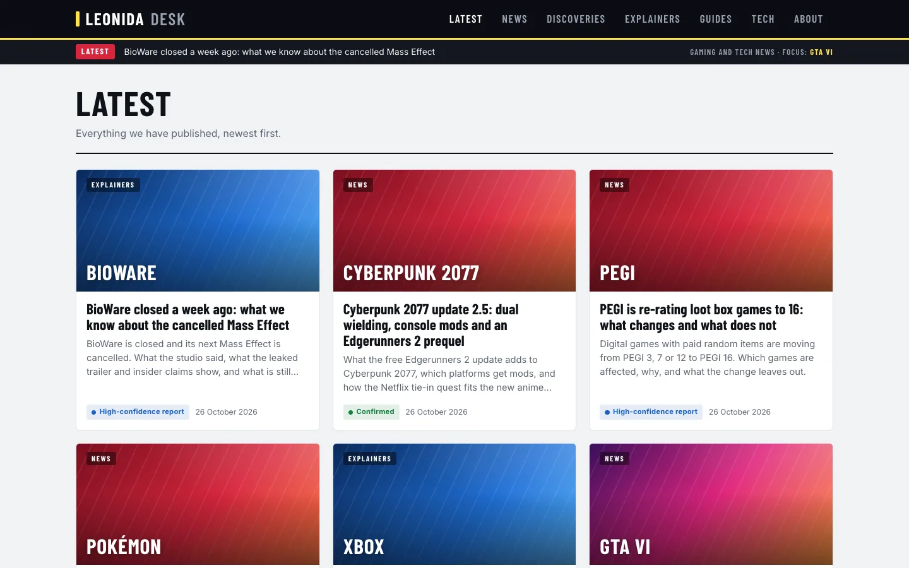

# Leonida Desk: GTA VI content intelligence

An AI-run digital publication with one human editor. This is its research desk: one command produces a fresh, deduplicated, verified and scored editorial briefing.

**Live:** https://leonida-desk.farani-niccolas96.workers.dev/latest/ · **Case study:** [https://niccolas-farani.pages.dev/work/leonida-desk](https://niccolas-farani.pages.dev/work/leonida-desk/)



---

**Read [CLAUDE.md](CLAUDE.md) for the full spec and editorial rules.**

## Quick start

```bash
python -m venv .venv && source .venv/bin/activate
pip install -r requirements.txt
cp .env.example .env                  # add ANTHROPIC_API_KEY (optional: YOUTUBE_API_KEY)
python scripts/check_sources.py       # first run: see which feeds work from your network
python scripts/morning.py             # → outputs/briefings/latest.md
```

In Claude Code: `/morning` (runs the pipeline, then verifies and sweeps for anything missed).

After publishing: `python scripts/mark_used.py --rank 1 --platform tiktok --url <url>` (starts the 72h cooldown).

## Modes
| | Feeds | Web search | Editorial judgement |
|---|---|---|---|
| With `ANTHROPIC_API_KEY` | ✓ | ✓ (Claude, tool-result URLs only) | Claude |
| Without key / `--no-llm` | ✓ | ✗ | heuristics (flagged in briefing) |

## Tests
`python -m pytest -q` (offline, synthetic `.test` data).
